  

<b>Click the banner to press start.</b>

  I take AI research papers and turn them into small experiments you can run. 
  Latest: <a href="https://woletee.github.io/diffusion-papers-/can-ai-learn-to-sleep/">Can AI learn to sleep?</a>

